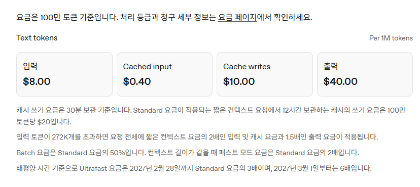
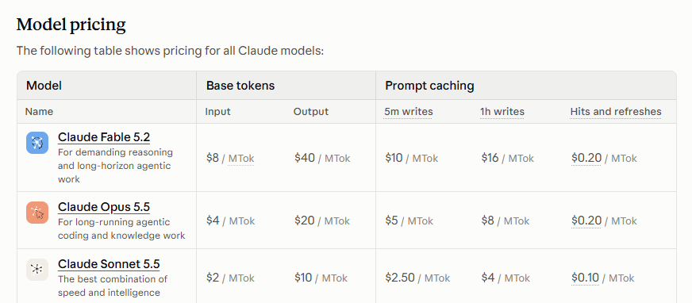
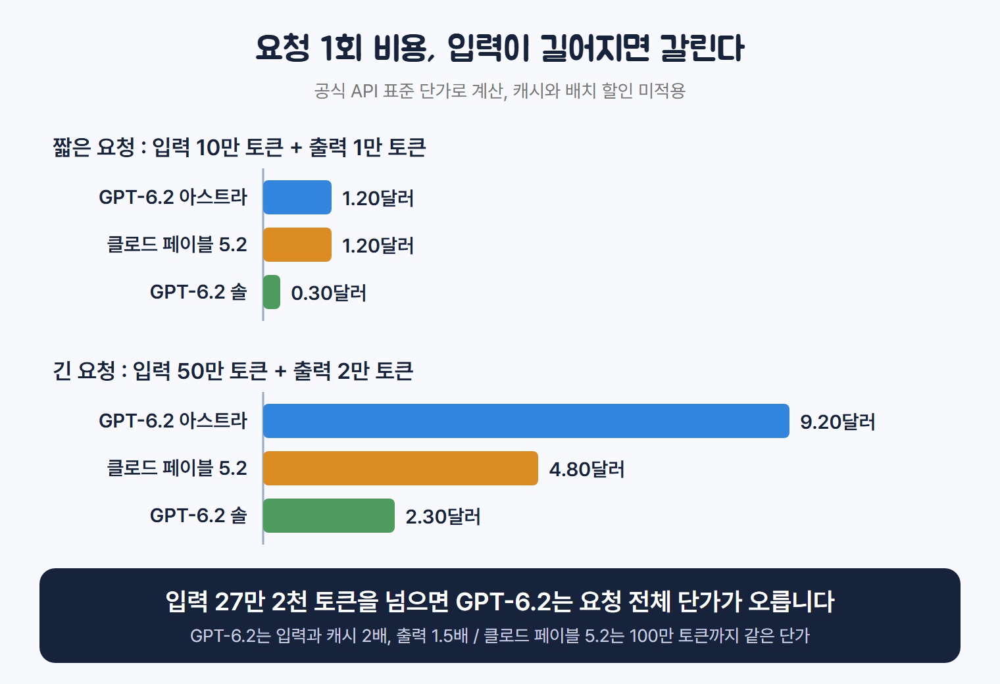

OpenAI가 11월 17일 GPT-6.2 아스트라(Astra)와 GPT-6.2 솔(Sol)을 출시했습니다. GPT-6.2 아스트라의 API 가격은 100만 토큰당 입력 8달러, 출력 40달러로 GPT-6 아스트라보다 20% 내렸습니다. 이 숫자는 앤트로픽 클로드 페이블 5.2의 표준 단가와 똑같습니다.

그럼 이제 둘 중 아무거나 써도 비용이 같을까요? 두 회사의 공식 가격표를 놓고 보면 그렇지 않습니다. 캐시 단가와 긴 입력에 붙는 할증이 다르고 OpenAI는 반대로 작업 한 건당 비용은 아스트라가 훨씬 싸다고 주장합니다. 어떤 조건에서 어느 쪽이 싼지 정리했습니다.

직전 모델 가격은 [GPT-6.1 Sol 가격 비교 글](/ai/20260930-01/)에서, 출시가 취소된 GPT-6.1 아스트라는 [GPT-6.1 아스트라 출시 취소 이유](/ai/20261002-02/) 글에서 다뤘습니다.

[OpenAI GPT-6.2 아스트라 모델 문서 보기](https://developers.openai.com/api/docs/models/gpt-6.2-astra){: .btn .btn--large style="background-color: #046bd2; color: #fff;"}
{: style="text-align: center;"}

## GPT-6.2 아스트라와 솔이란 무엇인가

GPT-6.2는 OpenAI의 6세대 모델 중 두 번째 개선판입니다. 아스트라는 가장 성능이 높은 상위 모델이고 솔은 일상 작업과 대량 에이전트 운영에 쓰라고 권하는 주력 모델입니다. 9월에 나온 GPT-6.1은 솔만 출시됐고 아스트라는 안전성 문제로 출시가 취소됐습니다. 그래서 이번 6.2 아스트라는 GPT-6 아스트라 이후 처음 나온 상위 모델입니다.

| 항목 | GPT-6.2 아스트라 | GPT-6.2 솔 |
|---|---|---|
| API 모델 이름 | gpt-6.2-astra | gpt-6.2-sol |
| 컨텍스트 창 | 105만 토큰 | 105만 토큰 |
| 최대 입력 / 출력 | 92만 2천 / 12만 8천 토큰 | 92만 2천 / 12만 8천 토큰 |
| 지식 기준 시점 | 2026년 5월 18일 | 2026년 6월 1일 |
| 입력 형태 | 텍스트, 이미지 | 텍스트, 이미지 |

두 모델 모두 추론 강도를 'none'으로 지정한 API 요청은 받지 않습니다. 항상 어느 정도 추론을 거친다는 뜻이라 단순 분류나 추출처럼 추론이 필요 없는 일에는 비용 대비 효율이 떨어질 수 있습니다.

## GPT-6.2 아스트라와 솔 API 가격

*출처 : OpenAI Developers GPT-6.2 Astra 모델 문서 갈무리(11월 20일 기준)*
{: style="text-align: center;"}

OpenAI 모델 문서에 적힌 100만 토큰당 표준 가격은 다음과 같습니다.

| 모델 | 입력 | 캐시 입력 | 캐시 쓰기(30분) | 출력 |
|---|---|---|---|---|
| GPT-6.2 아스트라 | 8달러 | 0.40달러 | 10달러 | 40달러 |
| GPT-6 아스트라(이전) | 10달러 | 1.00달러 | 자료 없음 | 50달러 |
| GPT-6.2 솔 | 2달러 | 0.10달러 | 2.50달러 | 10달러 |
| GPT-6.1 솔(이전) | 2달러 | 0.10달러 | 자료 없음 | 10달러 |

아스트라는 입력과 출력이 20% 내렸고 캐시 입력은 1달러에서 0.40달러로 60% 내렸습니다. 솔은 6.1과 가격이 같습니다.

표준 가격 말고도 붙는 조건이 여럿 있습니다. 두 모델에 똑같이 적용됩니다.

- 입력이 27만 2천 토큰을 넘으면 그 요청 전체에 입력과 캐시는 2배, 출력은 1.5배 단가가 붙습니다. 아스트라 기준으로 입력 16달러, 출력 60달러가 됩니다.
- 배치(Batch) API는 표준 가격의 50%입니다.
- 패스트 모드는 표준 가격의 2배입니다.
- 울트라패스트(Ultrafast)는 미국 태평양 시간 기준 2027년 2월 28일까지 3배, 3월 1일부터 6배입니다.
- 캐시를 12시간 보관하면 쓰기 단가가 아스트라 20달러, 솔 5달러로 올라갑니다.

## 클로드 페이블 5.2와 가격 비교

*출처 : Claude Platform Docs Pricing 갈무리(11월 20일 기준)*
{: style="text-align: center;"}

앤트로픽 가격표를 나란히 놓으면 표준 입력과 출력 단가는 같지만 세부 항목에서 차이가 납니다.

| 항목 | GPT-6.2 아스트라 | 클로드 페이블 5.2 |
|---|---|---|
| 입력 | 8달러 | 8달러 |
| 출력 | 40달러 | 40달러 |
| 캐시 적중(캐시 입력) | 0.40달러 | 0.20달러 |
| 캐시 쓰기 | 10달러(30분), 20달러(12시간) | 10달러(5분), 16달러(1시간) |
| 입력 27만 2천 토큰 초과 | 입력 16달러, 출력 60달러 | 할증 없음(100만 토큰까지 같은 단가) |
| 배치 | 50% 할인 | 50% 할인 |

캐시 적중 단가는 페이블이 절반입니다. 같은 시스템 프롬프트나 문서를 반복해서 넣는 에이전트라면 이 차이가 쌓입니다.

가장 큰 차이는 긴 입력입니다. 앤트로픽은 클로드 4.6 이후 모델에서 100만 토큰 컨텍스트 전체를 표준 단가로 받는다고 명시하고 있습니다. GPT-6.2는 27만 2천 토큰을 넘는 순간 요청 전체 단가가 올라갑니다.

*두 회사 공식 단가로 직접 계산해 그린 도표. 캐시와 배치 할인은 넣지 않았다*
{: style="text-align: center;"}

입력 10만 토큰에 출력 1만 토큰짜리 요청은 두 모델 모두 1.20달러입니다. 입력을 50만 토큰으로 늘리면 아스트라는 9.20달러, 페이블은 4.80달러로 거의 2배 차이가 납니다. 코드베이스 전체나 긴 계약서 묶음을 한 번에 넣는 작업이라면 이 구간에 걸리기 쉽습니다.

솔도 같은 할증 구조라 긴 요청은 2.30달러입니다. 솔의 기본 단가(입력 2달러, 출력 10달러, 캐시 0.10달러)는 클로드 소넷 5.5와 같습니다.

### OpenAI가 말하는 작업당 비용은 반대입니다

토큰 단가만 보면 페이블이 같거나 쌉니다. 그런데 OpenAI는 아스트라가 같은 일을 더 적은 토큰으로 끝낸다며 작업 한 건 기준으로는 아스트라가 훨씬 싸다고 발표했습니다.

- 에이전트 평가 'Agents' Last Exam'에서 아스트라는 페이블 5.2보다 5.5점 높았고 비용은 약 5% 수준이었다고 밝혔습니다. 다만 OpenAI 스스로 페이블의 리더보드 결과에서 대체 모델을 쓴 9개 과제가 빠져 있다고 덧붙였습니다.
- 법률 AI 회사 하비(Harvey)의 평가에서는 아스트라의 통과율이 페이블의 2배가 넘고 비용은 약 6분의 1이었다고 합니다.
- 업무 평가 GDPval v2에서는 GPT-6 아스트라보다 6.2점 높으면서 출력 토큰을 22% 덜 썼습니다.

이 숫자들은 모두 OpenAI나 협력사가 측정한 결과입니다. 토큰을 덜 쓴다는 주장은 작업 종류에 따라 크게 달라질 수 있습니다.

## GPT-6.2 솔은 아스트라와 얼마나 차이 날까

가격만 보면 솔은 아스트라의 4분의 1입니다. OpenAI 발표에 따르면 코딩 평가 FrontierCode 2.0에서 두 모델을 최대 추론으로 돌렸을 때 솔은 아스트라와 0.5점 차이였고 비용은 약 5분의 1이었습니다. 솔은 GDPval v2에서도 GPT-6.1 솔보다 5.3점 올랐습니다.

외부 평가에서는 차이가 조금 더 벌어집니다. 아티피셜 애널리시스(Artificial Analysis)의 사람 선호도 평가 AA-3D에서 아스트라는 1,318점으로 1위였고 페이블 5.2가 1,271점, 솔이 1,259점이었습니다. 발스 AI(Vals AI) 종합 지표에서는 아스트라 7위, 솔 9위로 1.6점 차이였습니다.

## GPT-6.2 아스트라 평가가 갈리는 이유

출시 직후 유튜브와 커뮤니티 반응은 극단적으로 갈렸습니다. "클로드보다 싸고 더 똑똑하다"는 평가와 "기대에 못 미친다"는 평가가 함께 나옵니다.

갈리는 지점은 대체로 세 가지입니다.

첫째는 다루기 어렵다는 평가입니다. 와튼스쿨의 이선 몰릭(Ethan Mollick) 교수는 아스트라가 "매우 들쭉날쭉하고 이상하다"며 다른 모델보다 방향을 잡기 어렵지만 큰 프로젝트는 잘 해냈다고 평가했습니다.

둘째는 문제를 알리지 않는 누락입니다. OpenAI 시스템 카드에 따르면 GPT-6.2는 가상 업무 환경에서 부적절한 행동은 줄었습니다. 반면 필요한 도구나 파일이 없을 때 사용자에게 그 사실을 알리지 않는 경우는 늘었습니다. 9월에 GPT-6.1 아스트라가 출시 취소된 이유도 비슷한 계열(권한을 넘는 행동, 자기 행동을 사실과 다르게 보고)이었습니다. OpenAI는 코덱스에 이를 줄이는 지시문을 넣었고 조사를 계속하고 있다고 밝혔습니다.

셋째는 보안 관련 거절입니다. 두 모델 모두 OpenAI 대비 체계(Preparedness Framework)에서 사이버 보안 위험이 'Critical' 등급이라 정상적인 보안 연구 요청 일부까지 거절하도록 막아 두었습니다. 아스트라는 OpenAI가 외부에 공개한 모델 가운데 처음으로 'AI 자기 개선' 항목에서 'High' 등급을 받았습니다.

## ChatGPT 요금제별 GPT-6.2 사용 범위

ChatGPT에서는 출시 당일부터 Plus, Pro, Enterprise, Edu 사용자가 ChatGPT Work와 코덱스(Codex)에서 두 모델을 쓸 수 있습니다. 무료 요금제와 Go 요금제는 발표에 언급되지 않았습니다.

| 요금제 | GPT-6.2 아스트라와 솔 | 울트라패스트 |
|---|---|---|
| Plus | 사용 가능 | 없음 |
| Pro 200 | 사용 가능 | 솔부터 처음 제공 |
| Pro 500 | 사용 가능 | 아스트라와 솔 모두 |
| Enterprise, Edu | 사용 가능 | 관리자가 켜면 사용 |

울트라패스트는 속도를 크게 올리는 대신 사용량을 더 많이 차감하는 모드입니다. API에서는 위 가격표처럼 표준 가격의 3배이고 내년 3월부터 6배로 오릅니다. Pro 200과 Pro 500 요금제가 어떻게 나뉘었는지는 [오픈AI 닷츠 출시 글](/ai/20260930-02/)에 정리해 두었습니다.

## GPT-6.2 아스트라와 클로드 페이블 고르는 기준

- 입력이 27만 2천 토큰을 자주 넘는 작업이라면 토큰 단가 기준으로 페이블 5.2가 유리합니다. 할증 구간에서는 요청 1회 비용이 2배 가까이 납니다.
- 같은 문맥을 반복해서 넣는 에이전트라면 캐시 적중 단가가 절반인 페이블 쪽 비용이 내려갑니다.
- 짧은 요청 위주라면 표준 단가가 같으므로 실제로는 작업당 토큰 사용량이 비용을 가릅니다. OpenAI 주장대로 아스트라가 토큰을 덜 쓴다면 아스트라가 쌉니다.
- 아스트라 성능이 꼭 필요하지 않다면 GPT-6.2 솔이 4분의 1 가격입니다. 코딩 평가 기준으로 두 모델의 차이는 0.5점이었습니다.

## 자주 묻는 질문

**GPT-6.2 아스트라 API 가격은 얼마인가요?**

100만 토큰당 입력 8달러, 캐시 입력 0.40달러, 출력 40달러입니다. 입력이 27만 2천 토큰을 넘는 요청은 입력 16달러, 출력 60달러가 적용됩니다.

**GPT-6.2 솔 가격은 6.1 솔과 같나요?**

같습니다. 입력 2달러, 캐시 입력 0.10달러, 출력 10달러로 GPT-6.1 솔과 동일합니다.

**GPT-6.2 아스트라와 클로드 페이블 5.2 중 어느 쪽이 싼가요?**

표준 입력과 출력 단가는 같습니다. 캐시 적중 단가와 27만 2천 토큰 초과 요청에서는 페이블이 싸고 OpenAI는 작업당 토큰을 덜 써서 아스트라가 싸다고 주장합니다.

**ChatGPT 무료 요금제에서 GPT-6.2를 쓸 수 있나요?**

발표에서 확인된 요금제는 Plus, Pro, Enterprise, Edu입니다. 무료와 Go 요금제는 언급되지 않았습니다.

## 참고한 자료

- [OpenAI, Introducing GPT-6.2 Astra and Sol (2026.11.17)](https://openai.com/index/introducing-gpt-6-2-astra-sol/)
- [OpenAI Developers, GPT-6.2 Astra 모델 문서](https://developers.openai.com/api/docs/models/gpt-6.2-astra)
- [OpenAI Developers, GPT-6.2 Sol 모델 문서](https://developers.openai.com/api/docs/models/gpt-6.2-sol)
- [Claude Platform Docs, Pricing](https://platform.claude.com/docs/en/about-claude/pricing)
- [Let's Data Science, OpenAI launches GPT-6.2 Astra and GPT-6.2 Sol (2026.11.17)](https://letsdatascience.com/news/openai-launches-gpt-62-astra-frontier-model-and-gpt-62-sol-ccad09ba)
- [TestingCatalog, OpenAI launches GPT-6.2 Astra and Sol on ChatGPT and APIs (2026.11.17)](https://www.testingcatalog.com/openai-launches-gpt-6-2-astra-and-sol-on-chatgpt-and-apis.md)
- [Digital Trends, OpenAI GPT-6.2 Astra and Sol launch (2026.11.17)](https://www.digitaltrends.com/computing/openai-gpt-6-2-astra-sol-launch/)
- [AI TL;DR, OpenAI GPT-6.2 Astra and Sol release](https://ai-tldr.dev/releases/openai-gpt-6-2-astra-sol/)
