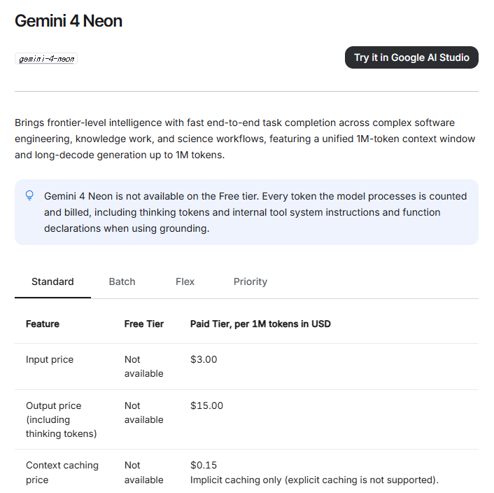
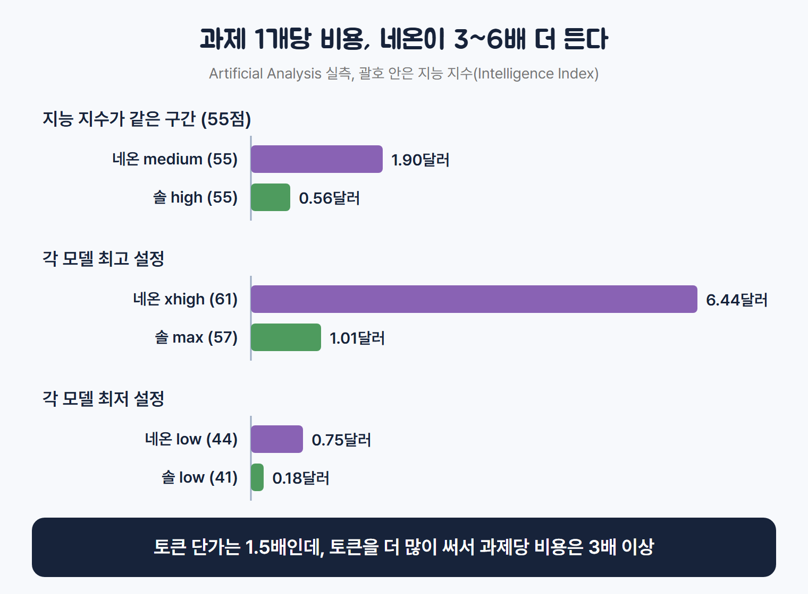

구글이 11월 18일 제미나이 4 네온(Gemini 4 Neon)을 출시했습니다. 제미나이 4 네온의 API 가격은 100만 토큰당 입력 3달러, 출력 15달러입니다. 하루 앞서 나온 OpenAI GPT-6.2 솔(입력 2달러, 출력 10달러)과 비교하면 단가가 정확히 1.5배입니다.

그럼 실제로 일을 시키면 1.5배만 더 들까요? 독립 평가 기관 아티피셜 애널리시스(Artificial Analysis)가 같은 과제를 두 모델에 돌린 결과, 과제 하나당 비용 차이는 3배에서 6배까지 벌어졌습니다. 반대로 입력이 아주 긴 요청에서는 네온이 더 쌉니다. 어떤 조건에서 누가 싼지 공식 가격표와 실측 수치로 정리했습니다.

GPT-6.2 솔과 아스트라 가격은 [GPT-6.2 아스트라와 솔 가격 총정리](/ai/20261120-01/) 글에서, 제미나이 4 첫 모델은 [제미나이 4 아르곤 성능과 가격 총정리](/ai/20261002-01/) 글에서 다뤘습니다.

[구글 제미나이 4 네온 발표 보기](https://blog.google/innovation-and-ai/models-and-research/gemini-models/introducing-gemini-4-neon/){: .btn .btn--large style="background-color: #046bd2; color: #fff;"}
{: style="text-align: center;"}

## 제미나이 4 네온이란 무엇인가

제미나이 4 네온은 구글 딥마인드의 제미나이 4 라인업(카본, 아르곤, 네온, 하이드로젠) 가운데 가장 최근에 나온 모델입니다. 구글은 네온을 "복잡한 소프트웨어 개발과 지식 업무, 과학 작업을 빠르게 끝까지 처리하는 프런티어급 모델"로 소개했습니다.

| 모델 | API 이름 | 구글 설명 |
|---|---|---|
| 제미나이 4 카본 | gemini-4-carbon | 가장 강력한 추론 모델 |
| 제미나이 4 아르곤 | gemini-4-argon | 카본보다 빠르고 토큰을 덜 쓰는 추론 모델 |
| 제미나이 4 네온 | gemini-4-neon | 빠른 작업 처리에 맞춘 프런티어급 모델 |
| 제미나이 4 하이드로젠 | gemini-4-hydrogen | 일상 코딩과 에이전트용 보급형 모델 |

네 모델 모두 컨텍스트 창은 100만 토큰입니다. 네온은 생각 수준을 low, medium, high, xhigh 네 단계로 고를 수 있고 기본값은 high입니다. GPT-6.2 솔은 low부터 max까지 다섯 단계입니다.

## 제미나이 4 네온과 GPT-6.2 솔 API 가격

*출처 : Google AI Studio Gemini API Pricing 갈무리(11월 20일 기준)*
{: style="text-align: center;"}

두 회사 공식 가격표의 100만 토큰당 표준 가격은 다음과 같습니다.

| 항목 | 제미나이 4 네온 | GPT-6.2 솔 |
|---|---|---|
| 입력 | 3달러 | 2달러 |
| 캐시 입력 | 0.15달러 | 0.10달러 |
| 출력(생각 토큰 포함) | 15달러 | 10달러 |
| 긴 입력 할증 | 가격표에 별도 구간 없음 | 27만 2천 토큰 초과 시 입력 2배, 출력 1.5배 |

입력, 캐시, 출력 모두 네온이 솔의 1.5배입니다. 두 모델 모두 생각(추론) 과정에서 쓰는 토큰도 출력 단가로 청구합니다. 그래서 같은 질문이라도 모델이 생각을 길게 할수록 비용이 올라갑니다.

### 입력이 길면 네온이 쌉니다

GPT-6.2 솔은 입력이 27만 2천 토큰을 넘으면 그 요청 전체에 입력 2배, 출력 1.5배 단가가 붙습니다. 구글 가격표에는 네온의 긴 입력 할증 구간이 따로 없습니다.

| 요청 1회(생각 토큰 제외) | 제미나이 4 네온 | GPT-6.2 솔 |
|---|---|---|
| 입력 10만 + 출력 1만 토큰 | 0.45달러 | 0.30달러 |
| 입력 50만 + 출력 2만 토큰 | 1.80달러 | 2.30달러 |

짧은 요청은 솔이 3분의 2 가격입니다. 입력이 50만 토큰으로 길어지면 솔에 할증이 붙어 네온이 0.50달러 쌉니다. 이 계산은 출력 토큰 수가 같다고 가정한 것이라 실제 비용은 아래처럼 모델이 토큰을 얼마나 쓰느냐에 따라 달라집니다.

### 12월 1일부터 카본과 아르곤 가격이 두 배로 오릅니다

구글 가격표에서 함께 확인할 점이 있습니다. 제미나이 4 카본과 아르곤은 11월 30일까지 입력 2달러, 출력 10달러이고 12월 1일부터 입력 4달러, 출력 20달러로 오릅니다. 지금은 네온(3달러, 15달러)이 카본보다 비싸지만 12월부터는 네온이 카본보다 25% 쌉니다.

## 제미나이 4 네온과 GPT-6.2 솔, 작업당 비용 비교

*Artificial Analysis 비교 페이지 수치로 직접 그린 도표*
{: style="text-align: center;"}

아티피셜 애널리시스는 자체 평가 과제를 모델과 생각 수준별로 돌려 지능 지수와 과제 1개당 평균 비용, 걸린 시간을 공개합니다. 네온 4단계와 솔 5단계 결과는 다음과 같습니다.

| 설정 | 지능 지수 | 과제당 비용 | 과제당 시간 |
|---|---|---|---|
| 네온 xhigh | 61 | 6.44달러 | 21.5분 |
| 네온 high | 60 | 3.74달러 | 14.8분 |
| 솔 max | 57 | 1.01달러 | 9.4분 |
| 솔 xhigh | 56 | 0.65달러 | 5.8분 |
| 솔 high | 55 | 0.56달러 | 5.0분 |
| 네온 medium | 55 | 1.90달러 | 8.3분 |
| 솔 medium | 53 | 0.41달러 | 3.5분 |
| 네온 low | 44 | 0.75달러 | 3.7분 |
| 솔 low | 41 | 0.18달러 | 1.6분 |

지능 지수가 55점으로 같은 네온 medium과 솔 high를 놓고 보면 네온이 과제당 1.90달러, 솔이 0.56달러로 약 3.4배 차이입니다. 단가 차이(1.5배)를 감안해도 네온이 토큰을 2배 넘게 더 썼다는 계산이 나옵니다. 시간도 네온이 8.3분, 솔이 5.0분으로 더 걸렸습니다.

최고 설정끼리는 차이가 더 큽니다. 네온 xhigh는 지능 지수 61점으로 솔 max(57점)보다 4점 높지만 과제당 비용은 6.44달러로 솔의 약 6.4배입니다.

성능 상한은 네온이 높고 같은 성능을 얻는 데 드는 비용은 솔이 훨씬 적습니다. 지능 지수 57점을 넘는 결과가 꼭 필요한 일이 아니라면 비용 면에서는 솔이 유리합니다.

## 제미나이 4 네온 벤치마크, 구글 발표와 외부 평가

구글이 발표문에서 내세운 수치는 다음과 같습니다.

- 아티피셜 애널리시스 지능 지수 61점(xhigh)으로 전체 3위, 코딩 에이전트 지수 58.6점으로 1위
- 발스(Vals) 종합 지수 70.9%로 2위, 법률 조사와 세무 에이전트 평가 1위
- 새 평가 Agent Arena 지수 1,336점으로 2위
- Terminal-Bench 4.1 65.2%, FrontierCode 2.0 46.2%(high 기준)
- high 설정에서 카본보다 과제당 비용 32% 저렴

같은 평가에서 GPT-6.2 솔은 아티피셜 애널리시스 지능 지수 57점(max)이었고, 출시 직후 발스 지수에서는 9위였습니다. 순위로 보면 네온이 앞섭니다.

다만 비교 기준을 볼 필요가 있습니다. 구글이 "비용 32% 저렴"이라고 한 비교 대상은 같은 회사의 카본이고 GPT-6.2 솔과의 과제당 비용 비교는 발표문에 없습니다. 외부 분석에서도 네온이 xhigh 설정에서 출력 토큰을 매우 많이 쓰는 모델이라는 평가가 나왔습니다.

## 제미나이 4 네온 쓰는 법과 요금제

구글 발표에 따르면 네온은 다음 경로로 순차 제공됩니다.

- Gemini API와 Google AI Studio(유료 프로젝트만, 무료 등급 없음)
- 기업용 Gemini(API와 모델 선택 메뉴)
- 유료 Google AI Pro와 Ultra 구독자의 구글 안티그래비티(Antigravity)
- Pro와 Ultra 구독자의 Gemini 앱

GPT-6.2 솔은 ChatGPT Plus, Pro, Enterprise, Edu에서 쓸 수 있습니다. 두 회사 발표 모두 무료 요금제 제공은 언급하지 않았습니다.

## 제미나이 4 네온과 GPT-6.2 솔 고르는 기준

- 같은 성능에서 비용을 줄이는 게 우선이라면 솔이 과제당 3배 이상 쌉니다.
- 가장 높은 성능이 필요한 작업이라면 네온 xhigh가 지능 지수 61점으로 앞서지만 과제당 6달러가 넘습니다.
- 입력이 27만 2천 토큰을 넘는 긴 문서나 코드베이스 작업은 솔에 할증이 붙어 네온 쪽 단가가 낮아집니다.
- 이미 구글 생태계(안티그래비티, Gemini 앱, 구글 검색 그라운딩)를 쓰고 있다면 네온, ChatGPT와 코덱스를 쓰고 있다면 솔이 바로 쓰기 편합니다.

## 자주 묻는 질문

**제미나이 4 네온 API 가격은 얼마인가요?**

100만 토큰당 입력 3달러, 캐시 입력 0.15달러, 출력 15달러입니다. 출력에는 생각 토큰이 포함되고 무료 등급에서는 쓸 수 없습니다.

**제미나이 4 네온과 GPT-6.2 솔 중 어느 쪽이 싼가요?**

토큰 단가는 솔이 3분의 2입니다. 아티피셜 애널리시스 실측에서도 과제당 비용은 솔이 3배에서 6배 쌌습니다. 다만 입력이 27만 2천 토큰을 넘는 긴 요청은 솔에 할증이 붙어 네온이 쌀 수 있습니다.

**제미나이 4 네온은 무료로 쓸 수 있나요?**

쓸 수 없습니다. API는 유료 프로젝트에서만 쓸 수 있고 Gemini 앱과 안티그래비티는 Google AI Pro와 Ultra 구독자에게 제공됩니다.

**제미나이 4 네온은 카본보다 싼가요?**

11월 30일까지는 카본(입력 2달러, 출력 10달러)이 쌉니다. 12월 1일부터 카본이 입력 4달러, 출력 20달러로 오르면 네온이 더 쌉니다.

## 참고한 자료

- [Google, Introducing Gemini 4 Neon (2026.11.18)](https://blog.google/innovation-and-ai/models-and-research/gemini-models/introducing-gemini-4-neon/)
- [Google AI for Developers, Gemini API Pricing](https://ai.google.dev/gemini-api/docs/pricing)
- [Google AI for Developers, Gemini API Models](https://ai.google.dev/gemini-api/docs/models)
- [Artificial Analysis, Gemini 4 Neon vs GPT-6.2 Sol](https://artificialanalysis.ai/models/comparisons/gemini-4-neon-vs-gpt-6-2-sol)
- [OpenAI Developers, GPT-6.2 Sol 모델 문서](https://developers.openai.com/api/docs/models/gpt-6.2-sol)
- [Casrai, Google Launches Gemini 4 Neon at $3 per Million Input Tokens](https://casrai.org/news/gemini-4-neon-launch-pricing-science-benchmarks-2026)
