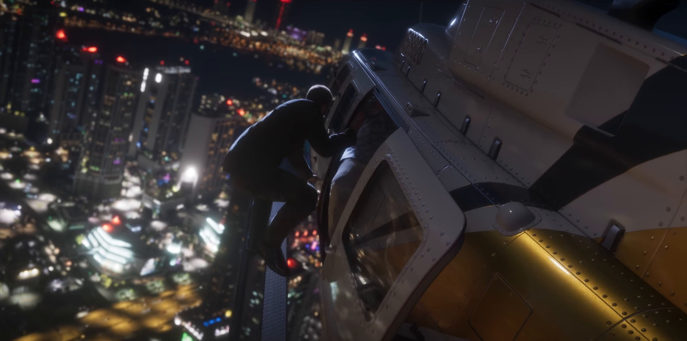
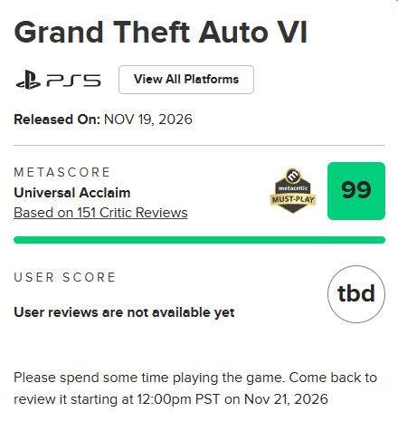
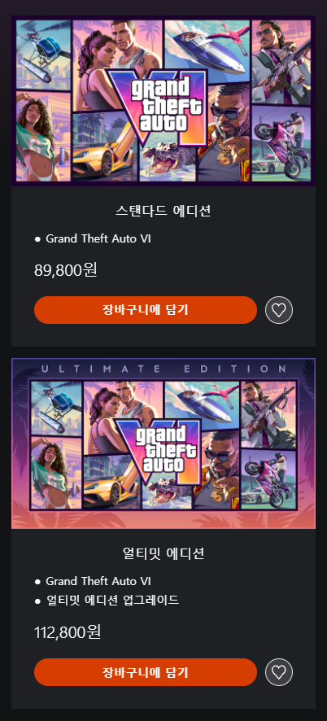

GTA6(Grand Theft Auto VI)가 11월 19일 PS5와 Xbox Series X/S로 출시됐습니다. 메타크리틱 점수는 99점이고 한국 PS 스토어 가격은 스탠다드 에디션 89,800원, 얼티밋 에디션 112,800원입니다.

두 에디션의 차이는 23,000원입니다. 본편 스토리와 지도는 같고 얼티밋에는 차량과 무기, 상점 같은 추가 아이템이 붙습니다. 이 23,000원이 값을 하는지, 패키지판과 디지털판은 무엇이 다른지, PC판을 기다리는 게 맞는지 출시 다음 날 기준으로 정리했습니다.

공개 전 게임플레이 영상은 [GTA6 공식 게임플레이 공개 글](/game/20260828-01/)에서, PS5 프로 프레임 차이는 [GTA6 때문에 PS5 프로 사야 할까](/game/20260914-03/) 글에서 따로 다뤘습니다.

[PlayStation 공식 GTA6 페이지 보기](https://www.playstation.com/ko-kr/games/grand-theft-auto-vi/){: .btn .btn--large style="background-color: #046bd2; color: #fff;"}
{: style="text-align: center;"}

*출처 : Rockstar Games 대한민국 공식 유튜브 'Grand Theft Auto VI 출시 트레일러'*
{: style="text-align: center;"}

## GTA6 출시 첫날 성적과 메타크리틱 99점

*출처 : Metacritic 갈무리(한국 시간 11월 20일 기준)*
{: style="text-align: center;"}

메타크리틱 PS5판 점수는 평론 151개 기준 99점입니다. 1998년 '젤다의 전설 시간의 오카리나'와 같은 사이트 최고 점수입니다. 유저 점수는 아직 없습니다. 메타크리틱은 미국 태평양 시간 11월 21일 정오, 한국 시간으로 22일 새벽 5시부터 유저 리뷰를 받습니다.

한국 PS 스토어의 이용자 별점은 4.86점이고 평가 수는 12만 4,900건입니다.

판매량은 아직 공식 숫자가 없습니다. 시장조사업체 센서타워는 사전 주문을 포함해 출시일까지 약 2,458만 장, 23억 6천만 달러어치가 팔렸다고 추정했습니다. 이 가운데 약 75%가 PS5입니다. 디지털 판매만 센 수치이고 패키지는 빠져 있습니다. 테이크투(Take-Two)는 공식 판매량을 곧 공개하겠다고만 밝혔습니다.

출시 시각은 지역별 자정이었습니다. 한국은 11월 19일 0시에 열렸고 사전 다운로드는 11월 10일부터 받았습니다.

## GTA6 한국 가격과 에디션 비교

*출처 : PlayStation 한국 공식 사이트 갈무리(11월 20일 기준)*
{: style="text-align: center;"}

| 구분 | 스탠다드 에디션 | 얼티밋 에디션 |
|---|---|---|
| 한국 PS 스토어 가격 | 89,800원 | 112,800원 |
| 미국 가격 | 79.99달러 | 99.99달러 |
| 판매 형태 | 디지털, 패키지(다운로드 코드) | 디지털만 |
| 본편 스토리와 지도 | 같음 | 같음 |
| 얼티밋 추가 아이템 | 없음 | 포함 |

미국 가격을 원화로 바꾸면 스탠다드는 약 12만 원, 얼티밋은 약 15만 원 수준입니다. 한국 가격이 해외보다 3만 원 이상 쌉니다. 국내 출시 전에는 스탠다드가 10만 원을 넘길 거라는 예상이 많았지만, '마리오 카트 월드'와 같은 89,800원으로 정해졌습니다.

이와 별도로 Rockstar는 399.99달러(약 55만 원)짜리 컬렉터스 에디션을 북미에서 먼저 팔았습니다. 굿즈 묶음이고 게임 코드는 들어 있지 않습니다.

## 얼티밋 에디션에만 들어가는 아이템

Rockstar 스토어와 PS 스토어 설명을 기준으로 얼티밋 에디션의 추가분은 스토리 모드용 아이템입니다. PS 스토어는 이를 이동 수단과 차고, 무기, 외형, 특별 의뢰와 커스텀 네 갈래로 나눕니다. 해외 매체 집계로는 16종입니다.

| 분류 | Rockstar 스토어 목록의 항목 |
|---|---|
| 차량 | '95 Grotti Cheetah, '67 Vapid Dominator Buggy, Shitzu Squalo(보트), Ganado Retro Build, 제이슨의 은신처 차량 |
| 무기 | Hawk and Little Morgan 리볼버, 개인화 무기 변형 |
| 외형 | Vice City Styles, Goodtime Gear 의상 |
| 상점 | Rideout Customs 정비소, Sara's 미용실, Stock 305 의류점, Electric Fang 타투숍, One-Eyed Willie's 정비소 |
| 활동 | PTT Youngin$ 근거지 습격 등 |

이 아이템들은 처음부터 한꺼번에 열리지 않습니다. PS 스토어 설명대로 "제이슨과 루시아의 스토리 전반에 걸쳐" 나오기 때문에, 스토리를 진행해야 하나씩 쓸 수 있습니다.

반대로 얼티밋에 없는 것도 분명합니다. 추가 미션이나 새 지역, 다른 결말은 없습니다. 스토리만 끝까지 보는 게 목적이라면 두 에디션의 체감 차이는 크지 않습니다.

### 지금은 얼티밋 업그레이드 단품을 살 수 없습니다

Rockstar 스토어는 스탠다드를 산 뒤 PS 스토어에서 언제든 얼티밋으로 업그레이드할 수 있다고 안내합니다. 그런데 11월 20일 현재 한국 PlayStation 사이트의 'Grand Theft Auto VI : 얼티밋 에디션 업그레이드(한국어판)' 항목은 '구매할 수 없음'으로 표시됩니다.

업그레이드 단품의 한국 가격도 아직 공개되지 않았습니다. 미국 Xbox 스토어에서는 두 에디션 차액과 같은 20달러로 올라와 있다는 해외 보도가 있습니다. 스탠다드를 먼저 사고 나중에 판단하겠다면 업그레이드가 언제 열릴지는 지금으로서는 알 수 없습니다.

### 조기 구매 특전은 11월 19일 구매분까지였습니다

두 에디션 모두 받는 조기 구매 특전 '빈티지 바이스 시티 팩'은 Rockstar 스토어 기준으로 11월 20일 이전 구매분까지입니다. 스토어 목록상 구성은 클래식 차량 컬렉션, '55 Vapid Stanier 세단과 차고, 의상과 헤어스타일, 전용 무기 패턴입니다. 오늘부터 사는 경우 이 팩은 빠질 수 있습니다.

디지털 구매자에게 주던 GTA+ 1개월 무료 이용권도 같은 시점을 기준으로 합니다. PS5는 2027년 3월 31일까지, Xbox는 주문일로부터 180일 안에 등록해야 합니다. 무료 기간이 끝나면 해지하지 않는 한 정가로 자동 갱신됩니다.

## GTA6 패키지판은 디스크가 없습니다

스탠다드 에디션은 패키지로도 팔리지만 상자 안에는 디스크 대신 다운로드 코드만 들어 있습니다. Rockstar 스토어도 "실물 버전에는 다운로드 코드만 들어 있고 디스크는 포함되지 않는다"라고 적고 있습니다. 디스크 드라이브가 없는 PS5 디지털 에디션에서도 쓸 수 있지만 중고로 되팔기는 어렵습니다.

국내 정리 글에 따르면 PS5 패키지 코드는 한국 계정 전용입니다. 해외에서 산 PS5 패키지는 한국 계정에 등록되지 않을 수 있고, 코드는 한 번만 쓸 수 있어 다른 계정으로 옮길 수 없습니다. Xbox 코드는 지역 제한이 없다는 보도가 있지만 Rockstar가 직접 밝힌 내용은 아닙니다.

| 비교 | 디지털 스탠다드 | 패키지 스탠다드 | 디지털 얼티밋 |
|---|---|---|---|
| 가격 | 89,800원 | 판매처마다 다름 | 112,800원 |
| 디스크 | 없음 | 없음(코드만) | 없음 |
| 얼티밋 아이템 | 없음 | 없음 | 포함 |
| 되팔기 | 불가 | 코드 미사용 시만 | 불가 |

## GTA6 용량 212GB와 한국어 지원

Rockstar가 밝힌 최대 설치 용량은 기기에 따라 212GB입니다. 초기형 PS5(825GB)는 실제로 쓸 수 있는 공간이 약 667GB라서 GTA6 하나가 3분의 1가량을 차지합니다.

다운로드 시간은 회선 속도에 따라 크게 다릅니다. 212GB를 기준으로 계산하면 다음과 같습니다.

| 회선 속도 | 이론상 다운로드 시간 |
|---|---|
| 100Mbps | 약 4시간 43분 |
| 500Mbps | 약 57분 |
| 1Gbps | 약 28분 |

실제로는 PSN 서버 상황과 공유기 환경 때문에 이보다 더 걸립니다.

한국어는 지원합니다. Rockstar 스토어의 지원 언어 13개 목록에 한국어가 들어 있고 한국 PS 스토어 상품명에도 '한국어'가 붙어 있습니다. 국내 정리 글 기준으로 음성은 영어이고 자막을 한국어로 볼 수 있습니다. 게임물관리위원회 등급은 청소년이용불가입니다.

## GTA6 PC 출시일, 지금 알려진 것

PC판은 공식 발표가 없습니다. Rockstar는 PS5와 Xbox Series X/S만 출시했고, PC 사양도 공개하지 않았습니다.

현재 도는 날짜는 보도뿐입니다. 게임스비트(GamesBeat)가 익명 관계자를 인용해 2027년 초, 1분기 출시를 보도했고 Rockstar는 답하지 않았습니다. GTA5는 콘솔판이 나온 지 약 1년 7개월 뒤에 PC판이 나왔습니다. 분석가들은 GTA6도 12개월에서 18개월 간격을 예상합니다.

온라인 모드도 출시 시점에는 들어 있지 않습니다. GTA6 온라인은 2027년 추가가 거론되지만 Rockstar가 날짜를 밝힌 적은 없습니다.

지금 PC판을 기다리는 사람은 최소 몇 달, 길게는 1년 넘게 기다릴 수 있습니다. 'PC용 GTA6 키'를 판다는 사이트는 모두 가짜입니다. 아직 PC판 자체가 없습니다.

## GTA6 스탠다드와 얼티밋 고르는 기준

- 스토리를 한 번 끝까지 보는 게 목적이면 스탠다드 89,800원으로 충분합니다. 본편 내용은 같습니다.
- 차량 수집이나 커스텀, 상점 운영 같은 곁가지 콘텐츠를 오래 즐길 생각이면 얼티밋이 맞습니다. 지금은 업그레이드 단품이 막혀 있어 나중에 붙이기 어렵습니다.
- 패키지를 사고 싶다면 스탠다드만 고를 수 있고 상자 안은 코드뿐입니다.
- PC로 하고 싶다면 공식 발표가 나올 때까지 기다려야 합니다. 출시 시기는 보도로만 나와 있습니다.

## 자주 묻는 질문

**GTA6 스탠다드와 얼티밋 스토리가 다른가요?**

다르지 않습니다. 본편 스토리, 지도, 결말은 같고 얼티밋에는 차량, 무기, 의상, 상점 같은 스토리 모드 추가 아이템만 더 들어 있습니다.

**GTA6 스탠다드를 산 뒤 얼티밋으로 바꿀 수 있나요?**

Rockstar는 PS 스토어에서 업그레이드할 수 있다고 안내하지만, 11월 20일 현재 한국 PlayStation 사이트의 얼티밋 업그레이드 단품은 '구매할 수 없음'으로 표시됩니다. 한국 가격도 아직 공개되지 않았습니다.

**GTA6 패키지에 디스크가 들어 있나요?**

들어 있지 않습니다. 상자 안에는 다운로드 코드만 있고 PS5 패키지 코드는 한국 계정 전용으로 알려져 있습니다.

**GTA6 PC판은 언제 나오나요?**

공식 발표는 없습니다. 2027년 1분기 출시설은 게임스비트의 익명 관계자 보도이고 Rockstar는 확인하지 않았습니다.

## 참고한 자료

- [Rockstar Games, Grand Theft Auto VI 공식 페이지](https://www.rockstargames.com/VI)
- [Rockstar Store, Grand Theft Auto VI 구매 페이지](https://store.rockstargames.com/game/buy-gta-vi)
- [PlayStation 한국, Grand Theft Auto VI](https://www.playstation.com/ko-kr/games/grand-theft-auto-vi/)
- [Metacritic, Grand Theft Auto VI](https://www.metacritic.com/game/grand-theft-auto-vi/)
- [게임메카, GTA 6 한국 가격 스탠다드 89,800원 (2026.6.25)](https://www.gamemeca.com/en/view.php?gid=1776963)
- [게임메카, 게임 코드 없는 55만 원 컬렉터스 에디션 (2026.9.25)](https://www.gamemeca.com/en/view.php?gid=1781027)
- [Make Tech Easier, GTA 6 첫날 판매 추정 2,460만 장 (2026.11.20)](https://maketecheasier.com/gta-6-first-day-sales-estimate/)
- [VICE, GTA 6 예약 특전과 얼티밋 에디션 구성 (2026.11.16)](https://www.vice.com/en/article/gta-6-pre-order-bonuses-ultimate-edition/)
- [Jolt Journal, GTA 6 출시 가격과 리뷰, 용량 정리 (2026.11.19)](https://www.joltjournal.com/whats-hot/gaming/gta-6-launch-price-reviews/)
- [foxcg, GTA6 출시일과 가격, 사양 공식 확인분 정리 (2026.11.18)](https://foxcg.com/gta6-release-date-price-specs/)
