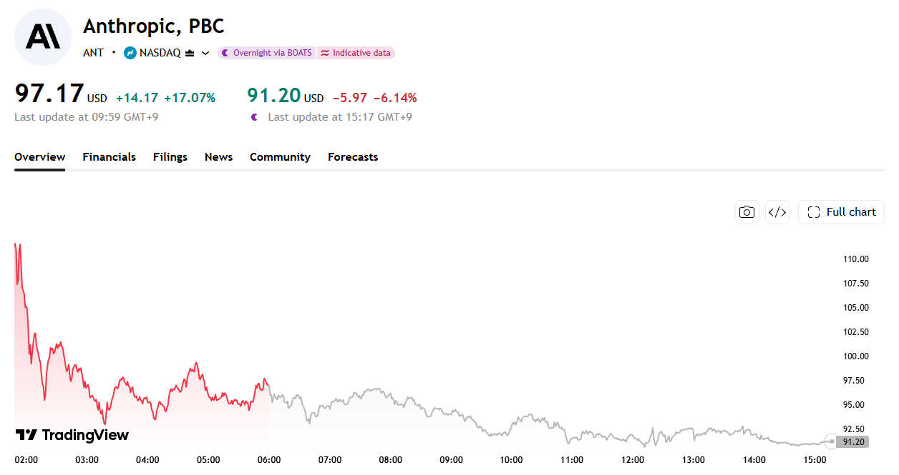
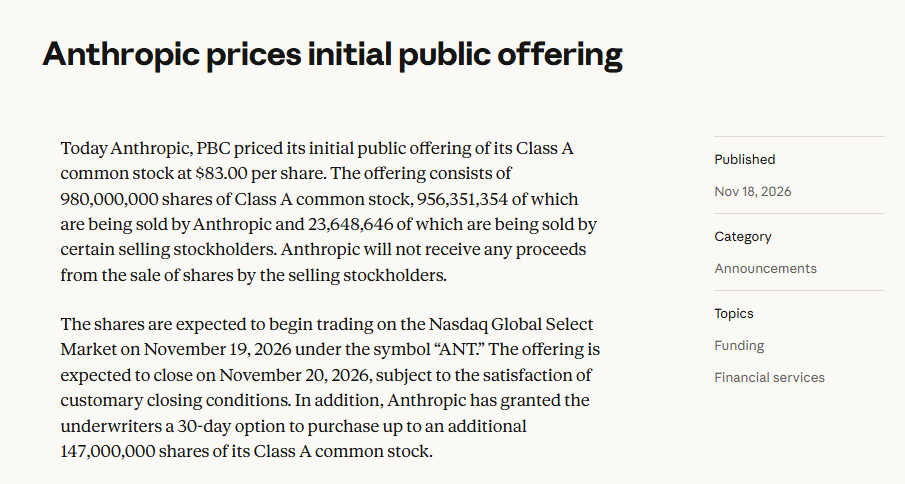
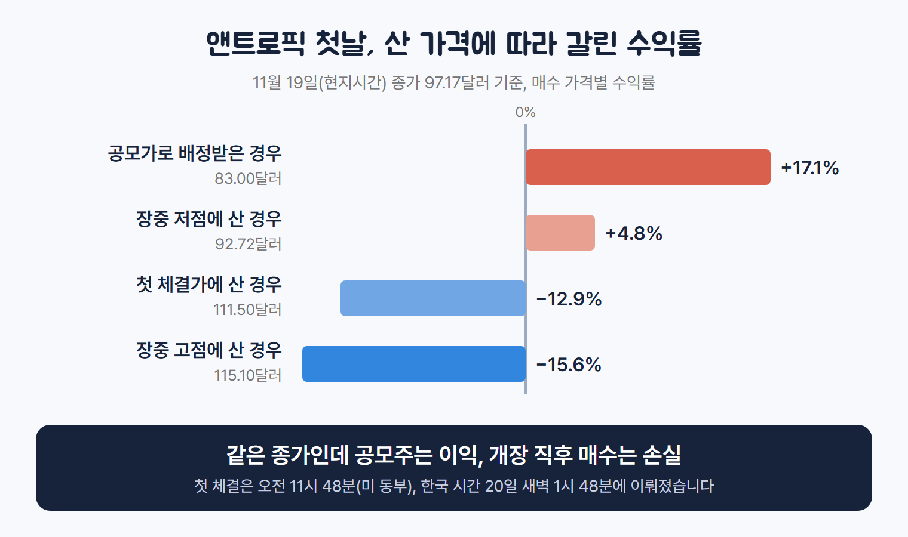

앤트로픽이 11월 19일(현지시간) 나스닥에 상장했습니다. 종목 코드는 ANT입니다. 공모가는 83달러였고 첫 체결가는 111.50달러, 종가는 97.17달러였습니다. 앤트로픽 주가는 공모가 기준으로 17.1% 오르며 첫날을 마쳤습니다.

그런데 개장 직후 첫 체결가에 산 사람은 같은 날 종가 기준으로 12.9% 손실입니다. 첫날 주가가 어떻게 움직였는지, 왜 매수 시점에 따라 결과가 갈렸는지 정리했습니다. 투자설명서에 적힌 다음 일정과 한국 투자자가 ANT를 살 때 걸리는 부분도 함께 담았습니다.

상장 전에 유출된 투자설명서 숫자(순손실 420억 달러, 인프라 약정 5180억 달러)는 [앤트로픽 상장 앞두고 드러난 숫자](/investment/20260929-01/) 글에서 따로 다뤘습니다.

[앤트로픽 공모가 확정 공지 보기](https://www.anthropic.com/news/anthropic-prices-initial-public-offering){: .btn .btn--large style="background-color: #046bd2; color: #fff;"}
{: style="text-align: center;"}

## 앤트로픽 상장 첫날 주가 흐름

*출처 : TradingView NASDAQ:ANT 페이지 갈무리(한국 시간 11월 20일 15시 17분 기준). 빨간 선이 정규장, 회색 선이 야간 거래*
{: style="text-align: center;"}

정규장 하루 동안 나온 가격을 시간 순서로 놓으면 다음과 같습니다. 시간은 모두 미국 동부 기준이고 한국 시간은 여기에 14시간을 더하면 됩니다.

| 구분 | 가격 | 공모가 대비 | 시점 |
|---|---|---|---|
| 공모가 | 83.00달러 | 기준 | 11월 18일 저녁 확정 |
| 첫 체결가 | 111.50달러 | +34.3% | 19일 오전 11시 48분 |
| 장중 고점 | 115.10달러 | +38.7% | 첫 체결 직후 |
| 장중 저점 | 92.72달러 | +11.7% | 오후 1시 18분 |
| 종가 | 97.17달러 | +17.1% | 오후 4시 |
| 시간외 마지막 체결 | 92.60달러 | +11.6% | 오후 7시 59분 |

장중 고점은 자료마다 114.99달러와 115.10달러로 조금 다릅니다. 표에는 ZDNet코리아가 쓴 115.10달러를 넣었습니다.

거래량은 CNBC 집계로 8억 4,600만 주를 넘었습니다. 지난 6월 상장한 스페이스X의 첫날 거래량은 5억 2,200만 주였습니다.

종가 기준 시가총액은 발행 주식 수로 계산하면 약 1조 2,700억 달러입니다. 희석 주식까지 넣으면 약 1조 7,700억 달러입니다. 같은 희석 기준으로 첫 체결가 때는 2조 달러 안팎까지 올라갔습니다. 기사마다 시총이 1조 3천억 달러, 1조 8천억 달러, 2조 달러로 다르게 나오는 이유가 이 계산 방식 차이입니다.

같은 날 시장 전체도 약했습니다. 나스닥 종합지수는 2.25% 내렸고 다우와 S&P 500도 2% 넘게 빠졌습니다. 한국 시간 20일 오후 3시 17분 트레이딩뷰에 표시된 야간 거래 가격은 91.20달러로, 정규장 종가보다 6.14% 낮았습니다.

## 앤트로픽 공모가 83달러는 어떻게 정해졌나

*출처 : Anthropic 공식 사이트 공지 갈무리*
{: style="text-align: center;"}

앤트로픽은 11월 10일 로드쇼를 시작하면서 공모 희망 범위를 주당 70~78달러로 냈습니다. 수요예측 결과 최종 공모가는 범위 상단보다 5달러 높은 83달러로 정해졌습니다.

공모 주식 수도 8억 2,500만 주에서 9억 8,000만 주로 늘었습니다. 이 가운데 9억 5,635만 주는 회사가 새로 찍은 신주이고, 2,365만 주는 기존 주주 몫입니다. 공동 창업자 7명이 각각 337만 8,378주씩 내놓은 것으로 나옵니다.

| 항목 | 규모 |
|---|---|
| 공모 금액 | 약 813억 달러(9억 8,000만 주 × 83달러) |
| 동시 사모 배정 | 260억 달러(구글, 엔비디아, AMD, 브로드컴, 마이크론, 마이크로소프트, TSMC) |
| 합계 | 약 1,073억 달러(약 143조 원) |
| 초과배정 옵션 | 최대 1억 4,700만 주(약 122억 달러), 30일 이내 행사 |

공모 금액 813억 달러는 지난 6월 스페이스X의 기본 공모액 750억 달러를 넘었습니다. 다만 스페이스X는 초과배정 옵션까지 행사해 최종 860억 달러 안팎을 모았습니다. 앤트로픽도 옵션이 행사돼야 이 숫자까지 넘어섭니다. 그래서 "역대 최대 IPO"라는 표현도 무엇을 기준으로 잡느냐에 따라 맞기도 하고 틀리기도 합니다.

한국경제에 따르면 청약에 참여한 글로벌 기관투자자 중 절반 이상이 한 주도 배정받지 못했습니다. 포춘은 주문이 공모 물량의 최대 7배까지 몰렸다는 인수단 쪽 이야기를 전했습니다.

## 시초가에 산 투자자가 손실을 본 이유

*언론 보도와 트레이딩뷰 가격을 바탕으로 직접 그린 도표*
{: style="text-align: center;"}

뉴스 제목의 "17% 상승"은 공모가 83달러를 기준으로 한 숫자입니다. 공모주를 배정받은 기관과 일부 개인만 이 가격에 샀습니다. 나머지 투자자는 장이 열린 뒤 시장에서 사야 했고 그 첫 가격이 111.50달러였습니다.

### 앤트로픽 시초가가 2시간 넘게 늦게 나온 이유

나스닥 정규장은 오전 9시 30분에 열리지만 ANT의 첫 체결은 오전 11시 48분에 나왔습니다. 신규 상장 종목은 나스닥의 'IPO 크로스'라는 개장 경매를 거칩니다. 매수 주문과 매도 주문을 모아 한 가격으로 맞추는 방식입니다.

이 경매에는 정해진 종료 시각이 없습니다. 주관사(앤트로픽은 골드만삭스와 모건스탠리)가 주문이 충분히 맞춰졌다고 나스닥에 알려야 첫 가격이 나옵니다. 사려는 주문이 압도적으로 많으면 그만큼 시간이 걸립니다. 스페이스X도 6월 상장 때 오전 11시 46분에 첫 체결이 나왔습니다.

### 장 시작가에 몰린 주문의 결과

경매가 늦어지는 동안 매수 대기 주문이 쌓였고 첫 가격은 공모가보다 34% 높은 곳에서 정해졌습니다. 그 뒤 1분 만에 고점을 찍고 오후 1시 18분에는 92.72달러까지 내려갔습니다. 종가 97.17달러는 첫 체결가보다 14.33달러 낮습니다.

공모주를 배정받은 투자자는 종가 기준 17.1% 이익이었습니다. 개장 직후 시장가로 주문을 넣은 투자자는 12.9%, 고점 근처에서 체결된 투자자는 15.6% 손실이었습니다.

한국 투자자는 공모주 배정을 받을 방법이 없었습니다. 그래서 국내에서 첫날 ANT를 산 사람은 모두 공모가보다 높은 시장 가격에 샀습니다.

## 앤트로픽 주식 한국에서 사는 법

### 한국에서 공모주 청약을 못 한 이유

앤트로픽 최종 투자설명서(424B4)의 한국 관련 조항은 이번 주식이 한국 자본시장법에 따라 등록되지 않았고 한국에서는 사모로만 판매된다고 적고 있습니다. 한국 일반 투자자에게 공모하려면 국내 증권신고서를 따로 내야 하는데 그 절차를 밟지 않았습니다.

테크42 보도에 따르면 투자설명서에 이름이 오른 인수 금융사 22곳 가운데 한국 증권사는 없었습니다. 개인 투자자 공모가 열린 곳은 미국과 호주, 캐나다, 일본, 스위스, 영국, 유럽경제지역 9개국이었습니다. 미국에서는 찰스슈왑, 피델리티, 로빈후드, 소파이, E*TRADE 같은 증권사에서 개인 청약을 받았습니다.

### 국내 증권사로 ANT 살 때 확인할 점

상장 이후에는 미국 주식 거래를 지원하는 국내 증권사 해외 주식 계좌로 살 수 있습니다. 주문할 때 걸리는 부분은 세 가지입니다.

- 종목명을 확인합니다. 영문 'ANT'나 'Ant'로 검색하면 중국 알리바바 계열 앤트그룹(Ant Group)이 함께 나오는 경우가 있습니다. 상장사 정식 이름은 Anthropic, PBC이고 거래소는 나스닥입니다.
- 정규장은 한국 시간 밤 11시 30분부터 다음 날 새벽 6시까지입니다(미국 서머타임이 끝난 11월 기준). 이번 첫 체결도 한국 시간 20일 새벽 1시 48분에 나왔습니다.
- 한국 낮 시간의 주간 거래는 미국 기준으로 야간 시장(블루오션 ATS)이라 정규장 가격과 차이가 날 수 있습니다. 트레이딩뷰에 Overnight로 표시된 91.20달러가 이 가격입니다. 증권사마다 주간 거래 지원 여부와 대상 종목이 다릅니다.

직접 사지 않고 간접적으로 노출되는 방법도 거론됩니다. SK텔레콤은 2023년 앤트로픽에 1억 달러를 투자한 초기 투자자입니다. 상장으로 이 지분에도 시장 가격이 매겨지게 됐습니다. 국내외 운용사들은 상장 이후 앤트로픽 편입을 염두에 둔 AI ETF를 내놓고 있지만 실제 편입 시점과 비중은 상품마다 다릅니다.

## 앤트로픽 주가에 영향을 줄 다음 일정

상장 첫날 이후 주가에 영향을 줄 일정은 대부분 투자설명서에 날짜가 적혀 있습니다. 가장 큰 변수는 보호예수(락업) 해제입니다. 보호예수는 기존 주주와 임직원이 상장 후 일정 기간 주식을 팔지 못하게 묶어 두는 약속입니다. 풀리는 날에는 시장에 나올 수 있는 물량이 늘어납니다.

앤트로픽은 이 물량을 한 번에 풀지 않고 여러 번에 나눠 풉니다. 투자설명서 'Shares Eligible for Future Sale' 항목에 적힌 일정은 다음과 같습니다.

| 날짜 | 내용 | 규모 |
|---|---|---|
| 11월 19일 | 창업자가 아닌 임직원 보유분 중 최대 10% 매도 가능 | 최대 3억 1,500만 주 |
| 11월 20일 | 공모 납입 마감(클로징) | 공모 9억 8,000만 주 |
| 12월 15일 | 보호예수 1차 단계 해제 | 최대 3억 300만 주 |
| 12월 18일 전후 | 초과배정 옵션 행사 기한(30일) | 최대 1억 4,700만 주 |
| 2027년 1월 5일 | 단계 해제 | 최대 3억 300만 주 |
| 2027년 1월 19일 | 단계 해제 | 최대 3억 5,300만 주 |
| 2027년 2월 2일 | 단계 해제 | 최대 3억 5,300만 주 |
| 2026 회계연도 실적 발표 2거래일 뒤 | 대규모 해제 | 최대 17억 주 |
| 2027년 1분기 실적 발표 2거래일 뒤와 상장 180일 중 빠른 날 | 일반 보호예수 종료 | 최대 30억 주 |
| 상장 후 최대 365일 | 공동 창업자와 지분 0.5% 초과 주주 보호예수 종료 | 별도 |

표의 '최대'는 클래스 A와 클래스 N 주식을 합친 상한입니다. 실제로 그만큼 시장에 나온다는 뜻은 아닙니다. 투자설명서는 단계 해제분을 모두 합하면 180일 보호예수 대상 가운데 약 37억 주가 그 기간이 끝나기 전에 팔 수 있게 된다고 적고 있습니다.

12월 18일 전후의 초과배정 옵션은 성격이 다릅니다. 주가가 공모가 위에 있으면 인수단이 옵션을 행사해 회사가 추가로 주식을 발행합니다. 반대로 공모가 아래로 내려가면 안정화 담당인 모건스탠리가 시장에서 주식을 사들여 공매도 포지션을 정리합니다.

첫 분기 실적 발표일은 아직 공지되지 않았습니다. 포춘에 따르면 울프리서치, 시티즌스, 멜리우스리서치 등은 상장 직후 매수 의견으로 분석을 시작했습니다.

## 자주 묻는 질문

### 앤트로픽 종목 코드는 무엇인가요?

ANT입니다. 나스닥 글로벌 셀렉트 마켓에 상장된 클래스 A 보통주이고 정식 회사명은 Anthropic, PBC입니다.

### 앤트로픽 주식은 한국에서 살 수 있나요?

공모 청약은 한국에서 열리지 않았지만 상장 이후에는 미국 주식을 지원하는 국내 증권사 해외 주식 계좌로 살 수 있습니다. 정규장은 한국 시간 밤 11시 30분부터 새벽 6시까지입니다.

### 앤트로픽 시가총액은 얼마인가요?

첫날 종가 97.17달러 기준으로 발행 주식 수로는 약 1조 2,700억 달러, 희석 주식까지 넣으면 약 1조 7,700억 달러입니다. 첫 체결가 기준으로는 2조 달러 안팎이었습니다.

### 앤트로픽 보호예수 해제는 언제인가요?

첫 단계 해제는 2026년 12월 15일이고 2027년 1월 5일, 1월 19일, 2월 2일에 이어서 풀립니다. 일반 보호예수는 2027년 1분기 실적 발표 2거래일 뒤와 상장 180일 가운데 빠른 날 끝나고 공동 창업자는 최대 365일 묶입니다.

## 참고한 자료

- [Anthropic, Anthropic prices initial public offering (2026.11.18)](https://www.anthropic.com/news/anthropic-prices-initial-public-offering)
- [SEC EDGAR, Anthropic, PBC 최종 투자설명서 424B4 (2026.11.19)](https://www.sec.gov/Archives/edgar/data/2130357/000162828026074944/0001628280-26-074944-index.htm)
- [ZDNet코리아, 앤트로픽 나스닥 데뷔 첫날 17% 상승 마감, 종가 97.17달러 (2026.11.20)](https://zdnet.co.kr/view/?no=20261120080221)
- [한국경제, 143조 빨아들인 앤트로픽, 상장 첫날 주가 롤러코스터 (2026.11.20)](https://www.hankyung.com/article/2026112088476)
- [KMJ, 앤트로픽 역대 최대 IPO에도 장중 상승분 반납, 시간외서도 4.7% 하락 (2026.11.20)](https://www.kmjournal.net/news/articleView.html?idxno=14300)
- [테크42, 세계 최대 AI 공모주, 한국 개인투자자는 왜 청약 못 하나 (2026.11.12)](https://www.tech42.co.kr/?p=123656)
- [Fortune, Anthropic stock pops to $2 trillion market cap in mega IPO (2026.11.19)](https://fortune.com/2026/11/19/anthropic-ipo-first-day-trading-nasdaq-record-valuation/)
- [Silicon Republic, Anthropic breaks SpaceX IPO record with $81.3bn raise (2026.11.19)](https://www.siliconrepublic.com/business/anthropic-breaks-spacex-ipo-record-with-81-3bn-raise)
- [StockTitan, Anthropic IPO Live, ANT's First Day of Trading (2026.11.19)](https://www.stocktitan.net/articles/anthropic-ipo-live-ant-first-trading-day-2026)

> 이 글은 2026년 11월 20일까지 나온 Anthropic 공지와 SEC 제출 최종 투자설명서(424B4), 국내외 언론 보도를 바탕으로 정리한 정보 제공 목적의 글이며 특정 종목의 매수나 매도를 권유하지 않습니다. 주가와 시가총액, 거래량은 2026년 11월 19일(미국 동부 시간) 거래와 한국 시간 11월 20일 오후 3시 17분 트레이딩뷰 화면 기준이고, 자료마다 소수점 단위로 차이가 있습니다. 주가와 일정은 계속 바뀔 수 있으니 실제 투자 전에는 원 출처와 증권사 공지에서 최신 내용을 다시 확인해야 하며, 투자에 따른 판단과 책임은 투자자 본인에게 있습니다.
>
> 차트 화면의 저작권은 TradingView에, 공시 화면의 저작권은 Anthropic에 있습니다.
