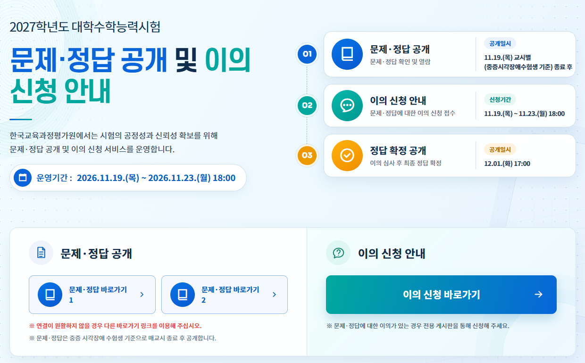
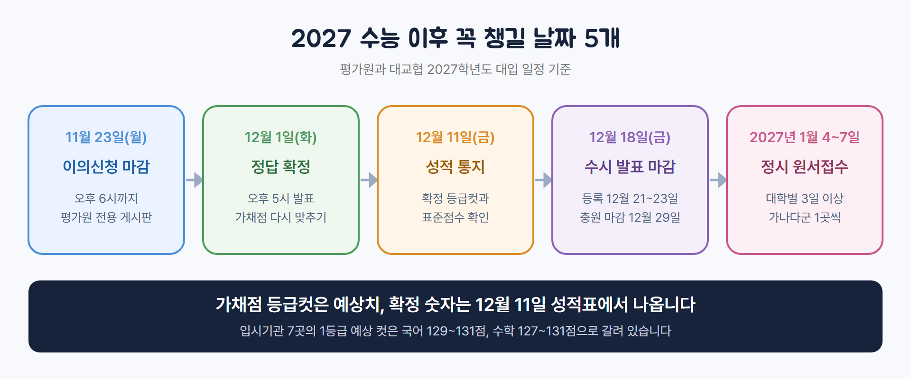

2027학년도 대학수학능력시험(수능)이 11월 19일 끝났습니다. 지원자는 55만 1,864명으로 지난해보다 2,310명 줄었지만, 졸업생 지원자는 17만 3,706명으로 비율이 31.5%까지 올랐습니다. 가채점을 마쳤다면 이제 남은 날짜는 11월 23일 오후 6시 이의신청 마감, 12월 1일 오후 5시 정답 확정, 12월 11일 성적 통지입니다.

지금 나와 있는 등급컷은 모두 입시기관이 가채점 자료로 낸 예상치입니다. 국어 1등급 예상 표준점수는 기관마다 129점에서 131점, 수학은 127점에서 131점까지 차이가 납니다. 이 숫자를 어떻게 읽어야 하는지, 성적표가 나오는 12월 11일까지 날짜별로 무엇이 남았는지 정리했습니다.

[평가원 2027 수능 문제와 정답, 이의신청 안내 보기](https://cdn2.kice.re.kr/imsi/27dae-suneung/index.html){: .btn .btn--large style="background-color: #046bd2; color: #fff;"}
{: style="text-align: center;"}

## 2027 수능 이후 일정 한눈에 보기

*출처 : 한국교육과정평가원 2027학년도 수능 문제와 정답 공개 및 이의 신청 안내 페이지 갈무리*
{: style="text-align: center;"}

평가원 공식 안내에 한국대학교육협의회(대교협) 2027학년도 대입 일정을 합쳐 수능 이후 일정을 표로 정리했습니다.

| 날짜 | 일정 | 비고 |
|---|---|---|
| 11월 19일(목) ~ 23일(월) 오후 6시 | 문제와 정답 이의신청 | 평가원 전용 게시판 |
| 11월 21일(토)부터 | 수시 대학별 논술과 면접 본격 시작 | 대학별 일정 |
| 12월 1일(화) 오후 5시 | 최종 정답 확정 발표 | 이의신청 심사 결과 포함 |
| 12월 11일(금) | 수능 성적 통지 | 확정 등급컷과 표준점수 |
| 12월 18일(금)까지 | 수시 합격자 발표 | 등록 12월 21일 ~ 23일 |
| 12월 29일(화) 오후 6시 | 수시 미등록 충원 합격 통보 마감 | 충원 등록 마감 30일 |
| 2027년 1월 4일 ~ 7일 | 정시 원서접수 | 대학별로 3일 이상 |

*평가원 안내와 대교협 대입 일정을 바탕으로 직접 그린 도표*
{: style="text-align: center;"}

## 2027 수능 이의신청 방법과 마감 시각

이의신청은 평가원 홈페이지의 이의신청 전용 게시판에서만 받습니다. 마감은 11월 23일 월요일 오후 6시입니다. 그 뒤에 올리거나 전용 게시판 밖에 올린 글은 심사하지 않습니다.

- 휴대폰이나 공공 아이핀으로 본인 인증을 한 뒤 글을 쓸 수 있습니다.
- 과목과 문항 번호, 이의 내용을 고르고 근거를 적는 방식입니다.
- 같은 문항에 같은 이유로 여러 번 올리는 중복 신청은 받지 않습니다.
- 글에 이름이나 수험번호 같은 개인정보는 적지 않습니다.

평가원은 이의신청 심사를 거쳐 12월 1일 오후 5시에 최종 정답을 발표합니다. 11월 19일 시험 당일 공개된 정답은 심사 전 자료입니다.

지난해(2026학년도) 수능 이의신청은 675건이었습니다. 영어가 467건으로 가장 많았고 국어 82건, 사회탐구 82건, 수학 23건, 과학탐구 17건 순이었습니다. 심사 결과 정답이 바뀐 문항은 없었습니다.

## 2027 수능 가채점 예상 등급컷

아래 숫자는 모두 입시기관이 수험생 가채점 자료로 추정한 값입니다. 교육 전문 매체 '교육을 비추다'가 11월 20일 새벽에 다시 확인한 기관별 수치를 기준으로 정리했습니다.

### 국어와 수학 1등급 예상 표준점수

| 기관 | 국어 | 수학 |
|---|---|---|
| 메가스터디 | 130점 | 131점 |
| 이투스 | 130점 | 128점 |
| 종로학원 | 131점 | 129점 |
| 진학사 | 129점 | 128점 |
| 대성마이맥 | 129점 | 127점 |
| EBSi | 129점 | 128점 |
| 유웨이 | 129점 | 128점 |

국어 1등급 예상 컷은 지난해 확정치 133점보다 2점에서 4점 낮습니다. 수학은 기관 간 차이가 최대 4점으로 국어보다 큽니다.

### 선택과목별 1등급 예상 원점수

| 영역 | 선택과목 | 1등급 예상 원점수 |
|---|---|---|
| 국어 | 화법과 작문 | 94 ~ 96점 |
| 국어 | 언어와 매체 | 90 ~ 91점 |
| 수학 | 확률과 통계 | 88 ~ 90점 |
| 수학 | 미적분 | 84 ~ 86점 |
| 수학 | 기하 | 86 ~ 88점 |

같은 1등급이라도 선택과목마다 원점수 기준이 다릅니다. 표준점수는 선택과목 간 난이도 차이를 조정한 점수입니다. 그래서 원점수가 같아도 어떤 과목을 골랐느냐에 따라 표준점수와 등급이 달라질 수 있습니다.

영어는 절대평가라 원점수 90점 이상이면 1등급입니다. 종로학원은 1등급 비율을 약 8%로 내다봤습니다. 지난해 영어 1등급 비율은 3.11%였습니다.

### 예상 등급컷이 기관마다 다른 이유

기관별 예상 컷이 다른 건 계산 재료가 다르기 때문입니다. 각 기관은 수험생이 자기 사이트에 입력한 가채점 점수로 분포를 추정합니다. 입력하는 수험생 집단이 기관마다 다르고 전체 응시자를 대표하지도 않습니다. 메가스터디의 실시간 영어 집계에서 1등급 비율이 17.77%로 나온 것도 상위권 수험생이 많이 입력한 결과일 가능성이 큽니다.

진학사는 20일 새벽 국어와 수학 컷을 1점씩 낮췄고 이투스는 국어를 1점 올렸습니다. EBSi도 수학 선택과목별 원점수 컷을 시험 당일 밤보다 내렸습니다. 예상치는 이렇게 계속 바뀝니다. 확정된 등급컷과 표준점수는 12월 11일 성적표에서 처음 나옵니다.

## 가채점 후 수시 논술과 면접, 가야 할까

수능 최저학력기준이 있는 수시 전형은 이번 주말부터 대학별 논술과 면접이 이어집니다. 건국대 KU논술우수자 전형은 11월 21일에 논술을 치르고 다른 주요 대학들도 21일과 22일에 일정이 몰려 있습니다.

응시 여부는 가채점 결과가 최저 기준에서 얼마나 떨어져 있는지로 갈립니다.

- 가채점 결과가 최저 기준을 여유 있게 넘는다면 대학별 고사에 응시해 수시 합격 가능성을 살립니다.
- 최저 기준 근처에 걸쳐 있다면 기관별 예상 컷 중 가장 높은 값으로 다시 계산해 봅니다. 그 값으로도 충족하면 응시하고, 그 값으로는 못 미친다면 정시 지원 가능성과 함께 비교합니다.

수시에 합격하면 등록 여부와 상관없이 정시에 지원할 수 없습니다. 가채점 점수로 정시에서 더 높은 대학을 노릴 수 있다면, 그보다 낮은 대학의 수시 대학별 고사는 응시하지 않는 선택지도 있습니다.

## 2027 수능 난이도와 부정행위 적발

출제위원장인 오기영 한경국립대 교수는 사교육에서 문제 풀이 기술을 반복 훈련한 학생에게 유리한 문항은 철저히 배제했다고 밝혔습니다. EBS 연계율은 문항 수 기준 50% 수준입니다. 영어는 6월과 9월 모의평가 결과를 반영해 난이도를 미세 조정했다고 설명했습니다. 출제위원장은 영어 1등급 비율이 안정적일 것으로 예상했습니다.

입시기관과 EBS는 대체로 국어와 영어가 지난해보다 쉬웠고 수학은 지난해와 비슷하거나 조금 어려웠다고 평가했습니다. 수학 공통과목 15번, 21번, 22번과 선택과목 30번이 변별 문항으로 꼽혔습니다. 국어 1등급 컷이 내려가고 영어 1등급 비율이 늘 것으로 예상되면서, 입시기관들은 상위권 변별이 수학과 탐구에서 갈릴 것으로 봤습니다.

교육부는 11월 20일 스마트기기 관련 부정행위가 최종 111건 적발됐다고 발표했습니다. 시험 당일 4교시 종료 시점의 잠정 집계는 98명이었고, 5교시까지 시험장별 추가 보고가 반영되면서 13건 늘었습니다. 시험 중 위급 재난 문자 경보음으로 적발된 경우가 54건, 다른 방법으로 적발된 경우가 52건이었습니다. 스마트안경과 소형 카메라, 문제지 촬영처럼 시험 중 실제로 기기를 사용한 사례도 5건 있었습니다. 교육부는 이의신청을 포함한 처리를 12월 11일 성적 발표 전에 마치겠다고 밝혔습니다.

## 자주 묻는 질문

**2027 수능 이의신청 마감은 언제인가요?**

11월 23일 월요일 오후 6시입니다. 평가원 홈페이지 이의신청 전용 게시판에서만 받습니다.

**2027 수능 정답 확정 발표는 언제인가요?**

12월 1일 화요일 오후 5시입니다. 11월 19일에 공개된 정답은 이의신청 심사 전 자료입니다.

**2027 수능 성적 발표일은 언제인가요?**

12월 11일 금요일입니다. 확정 등급컷과 표준점수, 백분위는 이날 성적통지표로 처음 확인할 수 있습니다.

**2027 수능 국어와 수학 1등급 컷은 몇 점인가요?**

입시기관 예상치로 국어 표준점수 129~131점, 수학 127~131점입니다. 공식 등급컷이 아니며 12월 11일 확정치와 다를 수 있습니다.

## 참고한 자료

- [한국교육과정평가원, 2027학년도 수능 문제와 정답 공개 및 이의 신청 안내](https://cdn2.kice.re.kr/imsi/27dae-suneung/index.html)
- [머니투데이, 23년 만에 역대급 N수생, 2027 수능 지원자 현황 (2026.9.8)](https://www.mt.co.kr/policy/2026/09/08/2026090810102413804)
- [베리타스알파, 수능 이의신청 19일부터 23일까지, 12월 1일 정답 확정 (2026.11.19)](https://www.veritas-a.com/news/articleView.html?idxno=637964)
- [교육을 비추다, 2027 수능 1등급 예상 원점수 컷 (2026.11.20)](https://www.kyobit.com/news/articleView.html?idxno=8265)
- [싱글리스트, 2027학년도 수능 예상 등급컷 공개 (2026.11.20)](https://www.slist.kr/news/articleView.html?idxno=783233)
- [한국일보, 수능 출제위원장 일문일답 (2026.11.19)](https://www.hankookilbo.com/news/article/A2026111908590002561)
- [파이낸셜뉴스, 수능 출제위원장 영어 난도 미세 조정 (2026.11.19)](https://www.fnnews.com/news/202611190915383010)
- [내외일보, 2027 수능 등급컷과 부정행위 현황 (2026.11.19)](https://www.naewoeilbo.com/news/articleView.html?idxno=2458649)
- [아시아경제, 교육부 스마트기기 등 수능 부정행위 적발 총 111건 (2026.11.20)](https://view.asiae.co.kr/article/2026112011443554647)
- [교육을 비추다, 2027학년도 대입 일정과 모집인원 (2026)](https://www.kyobit.com/news/articleView.html?idxno=4750)
- [스페셜타임스, 건국대 KU논술우수자 전형 논술고사 일정](https://www.specialtimes.co.kr/news/articleView.html?idxno=485175)
